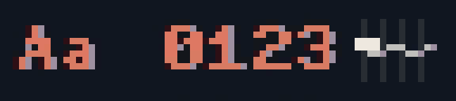

# Contrast Bench

Compare LED color pairs on the device and calculate WCAG relative luminance contrast.

Put the foreground and background directly on the LED matrix. The rear gives the contrast ratio while the front lets you see how the actual letters and digits read together.

## Compare two inks on the same paper

1. Start with the `Aa 0123` sample on the front. Turn the wheel to browse the six ink colors.
2. Compare the letters at the same viewing distance. Check the rear for the ink and paper hex values, ratio and threshold label.
3. The clip keeps the dark background in place while the ink changes from pale cream to coral.


## Change the background and save the pair

1. Click to switch the editing target to paper. Turn to choose a second background; the sample updates immediately.
2. Press **Start** to save the ink and paper together. Try another pair, then hold **Start** to recall the saved one.
3. Read the ratio on the rear for both combinations. The recording shows how a gold background changes the legibility of the coral sample.



## Example from the emulator

The app calculates the ratio from the two sRGB color values. Identical colors give 1:1. The rear uses 4.5:1 for the normal-text threshold and 3:1 for large text. Room light, physical LEDs and your viewing distance still affect what the sample looks like.

## Run in the emulator

Open BUSY Bar Emulator. From this repository, run:

```sh
~/.busy-emulator/bin/busy-emulator dev --once
```

Press **Back** to exit.

The GIFs are excerpts from the emulator recording. Each front-display pixel is shown at 9× its original width and height. The end frames pause for reading.

[Full recording](media/controls.mp4) · [Rear display](screenshots/back-1.png) · [Firmware test](EMULATOR-QA.md) · [MIT license](LICENSE)
